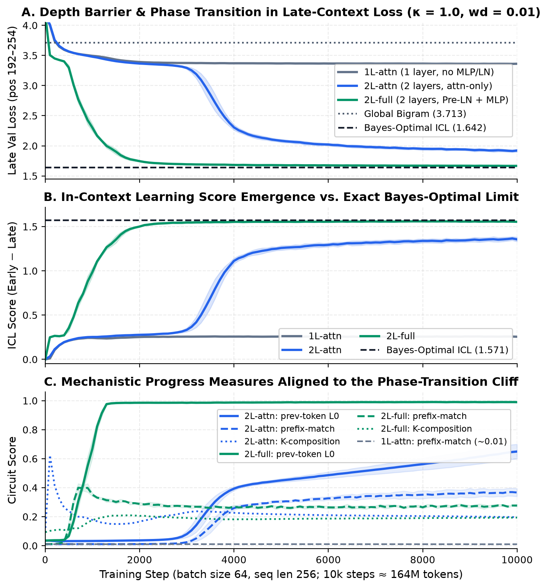
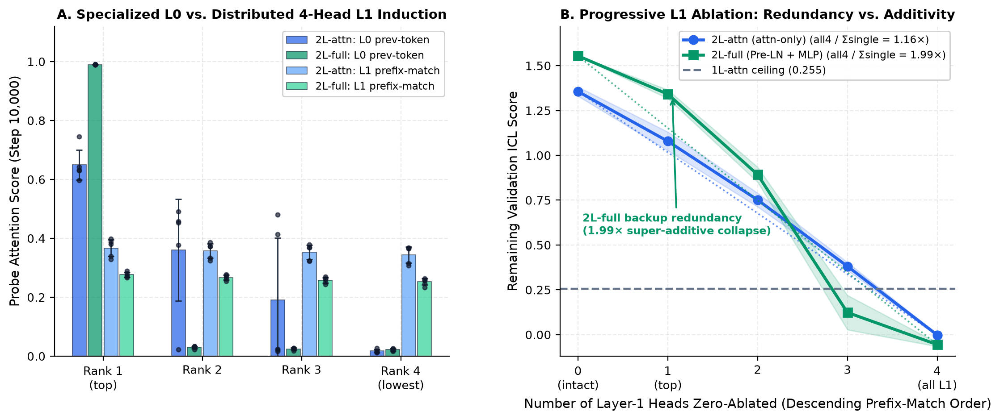
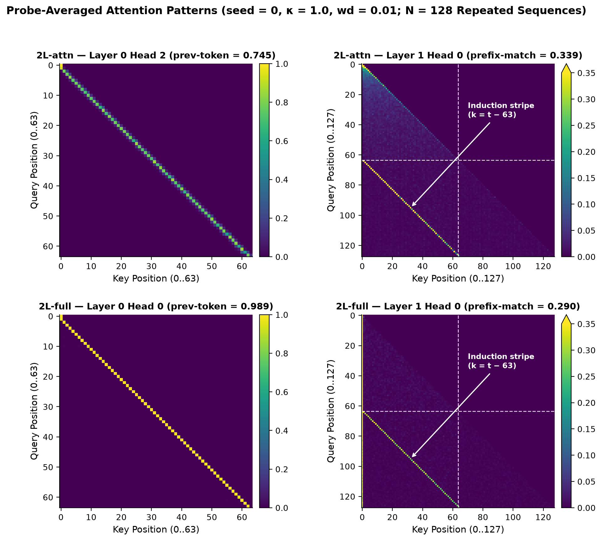
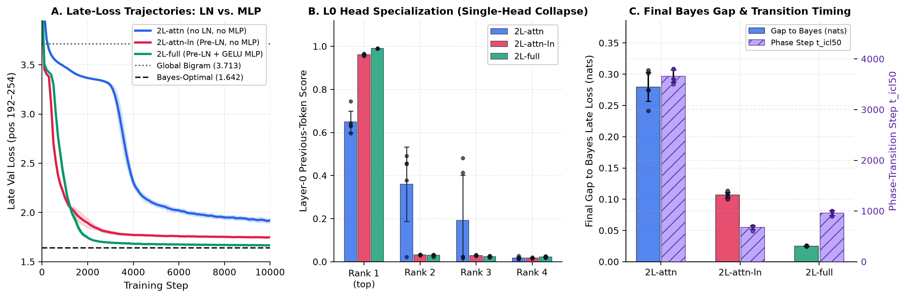
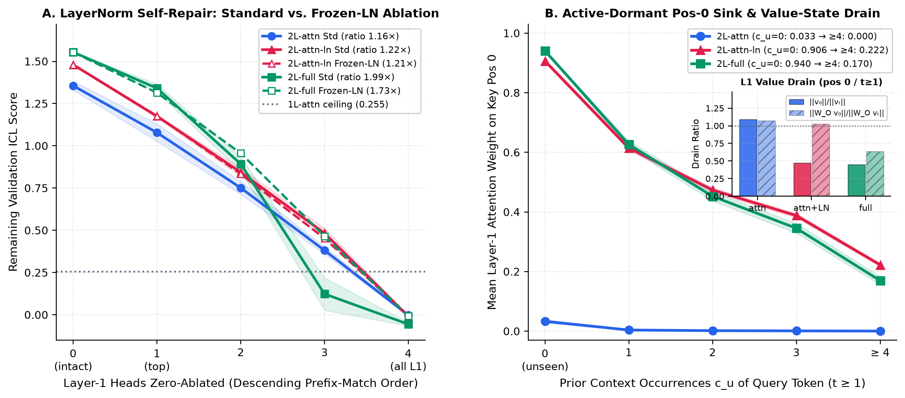
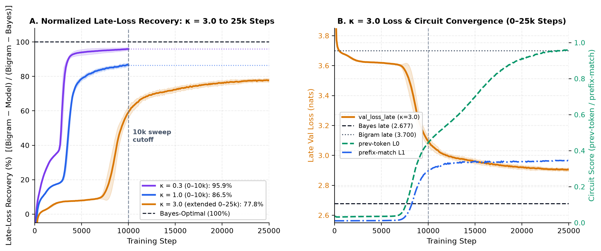

# Induction Heads & Emergent In-Context Learning — From-Scratch Reproduction, 35-Run Sweep & Mechanistic Dissection

From-scratch PyTorch + `einops` reproduction of **Olsson et al. (2022)** on online Zipfian In-Context Markov Chains (ICMC) with exact analytical **Global Bigram** and **Bayes-Optimal Dirichlet-Multinomial** baselines. Covers a **35-run** core sweep (`seeds 0–4`, `10,000` steps / `~164M` tokens per run; `50.45 min` on a single RTX 5070), plus **Stage 3 mechanistic extensions** (`+10` controlled runs: `2L-attn-ln` factorization, `κ = 3.0` 25k-step extension, Frozen-LN self-repair ablations, and active-dormant attention-sink / value-drain diagnostics).

> **Status: work in progress.** Sections 2–4 were corrected after a set of review diagnostics (logit-space ablations, absolute loss gaps, position-controlled sink analysis; [`src/review_diagnostics_v2.py`](src/review_diagnostics_v2.py), `artifacts/data/*_v2.csv`). One control is still to run: a 2-layer model with MLP but no LayerNorm (`2L-mlp`), which is needed before saying what the MLP does on its own. Limitations are in [Section 7](#7-limitations--open-questions).

## TL;DR

- **Hard 1-Layer Depth Barrier & Sharp 2-Layer Phase Transition:** `1L-attn` stays at an in-context unigram ceiling for all `10,000` steps (`val_loss_late = 3.362`, `icl_score = +0.255`, `prefix_match = 0.010`), whereas `2L-attn` undergoes a sharp phase transition at median step **`3,600`** (`86.5%` late-loss recovery toward exact Bayes-optimal) and `2L-full` transitions at median step **`1,000`**, reaching **`98.8%`** of exact Bayes-optimal late-context loss (`1.667` vs. `1.642`).
- **Pre-LayerNorm vs. MLP Factorization (`+768` LN params vs. `+264k` MLP params):** Adding **only** Pre-LayerNorm (`2L-attn-ln`, no MLP) delivers **100%** of the phase-transition speedup (`t_icl50 = 700` vs. `3,600`), **100%** of Layer-0 single-head collapse (`Rank 1 = 0.961` vs. `Rank 2 = 0.031`), **61.7%** of the Bayes-gap closure (`0.280 → 0.107` nats), and **all** of the active-dormant position-0 attention sink (`c_u = 0`: `0.033 → 0.906`). The MLP closes the final `0.082` nats to Bayes optimality (`1.749 → 1.667`).
- **Self-repair comes from LayerNorm:** Naive single-head L1 ablation looks unselective because **all `4 / 4` L1 heads** become induction heads (`120 / 120` heads across 30 2L checkpoints). Removing L1 heads one by one and measuring the correct-token **logit**, where head contributions add exactly unless something rescales them, removing all four costs **`1.47×`** the sum of the single-head drops in `2L-attn-ln` and **`1.25×`** in `2L-full`. Freezing the LayerNorm scale brings both to additivity or below (`1.00×` and **`0.97×`**), so LayerNorm rescaling accounts for essentially all of the redundancy. Measured in ICL score or loss instead, the ratios are distorted by the metric itself (`2L-attn`, exactly additive in logits, shows `1.16×`), which is why an earlier version of this README attributed ~74% of the redundancy to the MLP. Whether an MLP repairs anything without LayerNorm awaits the `2L-mlp` control.
- **Prior Concentration (`κ`):** Strong in-context signal (`κ = 0.3`) transitions early (`t_icl50 = 2,900`), while prior-dominated chains (`κ = 3.0`) delay onset to `8,500`. At `10,000` steps the gap to Bayes-optimal late loss is **`0.13` / `0.28` / `0.42` nats** for `κ = 0.3 / 1 / 3`, and none of the three has converged. Extending `κ = 3.0` to **`25,000` steps** narrows its gap to `0.23` nats; an exponential fit over steps 15k–25k puts the asymptote at **`0.20` nats** (bootstrap 95% CI `[0.18, 0.23]`), with the loss still falling by `0.003` nats per 1k steps. On the recovery-% scale `κ = 3.0` looks worse (`77.8%` at 25k, `80%` fitted) only because that scale divides by a smaller bigram-to-Bayes range (`1.02` nats vs. `2.07` at `κ = 1`).
- **Structural Contrast with Finite-Data Grokking:** In online infinite-data ICL, weight decay is **not** required for generalization (`wd = 0.0` achieves the best ICL). Increasing `wd ∈ {0.0, 0.01, 0.1}` monotonically damps `icl_score` and `prev_token_L0` across **5/5 seeds** (Friedman $p = 0.0067$) and delays `t_icl50` by `+300` steps ($p = 0.0087$), while monotonically raising Frobenius K-composition (`0.192 → 0.197 → 0.232`, **5/5 seeds**, $p = 0.0067$). The mechanism of that rise is open: the composed-matrix and OV norms of the top head pair both *grow* with weight decay while total weight norm falls.



---

## 1. Synthetic Task, Analytical Baselines & Architectures

- **Online Zipfian Dirichlet-Markov Data ([`src/data.py`](src/data.py)):** Vocabulary `V = 64`, sequence length `T = 256`. A fixed base transition matrix `P_base` (`data_seed = 12345`) permutes normalized `rank^(-0.8)` independently per row. Each fresh training sequence draws its own Markov matrix $P_i \sim \text{Dirichlet}(\kappa P_{\text{base}, i})$ on GPU via exact log-space Gamma boost ($\text{Gamma}(\alpha+1, 1) \cdot U^{1/\alpha}$ + softmax, eliminating float32 underflow at $\kappa = 0.3$) in chunked batches (`~0.4 ms / 64-seq batch`).
- **Fixed Deterministic Validation & Probe:** For each $\kappa \in \{0.3, 1.0, 3.0\}$, `n_val = 512` sequences (`val_seed = 99999`) carry exact precomputed **Global Bigram** ($-\log P_{\text{base}}[x_t, x_{t+1}]$) and **Bayes-Optimal ICL** ($(\kappa P_{\text{base}}[u] + \text{counts}[u]) / (\kappa + \sum \text{counts}[u])$) losses on early (`pos 1..31`) and late (`pos 192..254`) positions. A fixed repeated-token probe (`n_probe = 128`, `[r_0..r_63, r_0..r_63]`, zero consecutive duplicates) measures Olsson et al. prefix-matching (`t -> t - 63`) and L0 previous-token (`i -> i - 1`) scores.
- **Controlled Models ([`src/model.py`](src/model.py)):** Shared `d_model = 128`, `n_heads = 4` (`d_head = 32`), learned positional embeddings (`max_len = 256`), bias-free attention projections (`W_Q, W_K, W_V, W_O`), directly accessible `W_E, W_pos, W_U`, single-head zero-ablation hooks, and optional Frozen-LN-scale replay:
  1. `1L-attn` (`114,688` params): 1-layer attention-only, no MLP, no LayerNorm.
  2. `2L-attn` (`180,224` params): 2-layer attention-only, no MLP, no LayerNorm.
  3. `2L-attn-ln` (`180,992` params): 2-layer attention-only with Pre-LayerNorm + final `ln_f`, no MLP (`+768` params).
  4. `2L-full` (`444,928` params): 2-layer Pre-LayerNorm Transformer with `d_mlp = 512` GELU MLP.
- **Optimization ([`src/train.py`](src/train.py)):** Constant-LR `AdamW` (`lr = 1e-3`, `betas = (0.9, 0.98)`, weight decay on $\ge 2\text{D}$ tensors), `batch_size = 64`, logged every `100` steps. Throughput on RTX 5070: `4.8 s/1k` (`1L-attn`), `8.8 s/1k` (`2L-attn`), `9.2 s/1k` (`2L-attn-ln`), `12.0 s/1k` (`2L-full`); peak VRAM `≤ 659 MB`; disk `0.5–1.9 MB` per run.

---

## 2. Core 35-Run Sweep (`seeds 0–4`, `10,000` Steps)

Phase-transition timing is measured via `t_icl50` (first step crossing `50%` of final ICL gain above the pre-transition 1L plateau) and `t_slope` (midpoint of the `500`-step window with steepest drop in `val_loss_late`).

### Axis 1 — Architecture & Depth Barrier (`κ = 1.0`, `wd = 0.01`)

Analytical baselines at `κ = 1.0`: **Global Bigram** `late = 3.713` | **Bayes-Optimal** `late = 1.642`, `ICL = 1.571`.

| Arch | `val_loss_late` (mean ± std) | `icl_score` (mean ± std) | Late Recovery | `prevL0` | `pmatch` | `K-comp` | `t_icl50` med (range) | `t_slope` med (range) |
| :--- | :---: | :---: | :---: | :---: | :---: | :---: | :---: | :---: |
| **`1L-attn`** | `3.362 ± 0.002` | `0.255 ± 0.003` | `16.9%` | `0.041` | `0.010` | `n/a` | *never* | *never* |
| **`2L-attn`** | `1.922 ± 0.023` | `1.356 ± 0.026` | `86.5%` | `0.649` | `0.367` | `0.197` | **`3,600`** (`3,500–3,800`) | **`3,450`** (`3,450–3,650`) |
| **`2L-full`** | **`1.667 ± 0.001`** | **`1.554 ± 0.001`** | **`98.8%`** | **`0.990`** | `0.277` | `0.194` | **`1,000`** (`900–1,000`) | **`750`** (`650–750`) |

### Axis 2 — Prior Concentration Scaling (`2L-attn`, `wd = 0.01`)

| `κ` | Bigram / Bayes `late` | Model `val_loss_late` | `icl_score` (Bayes) | Late Recovery | `prevL0` | `pmatch` | `t_icl50` med (range) | `Δlate (9k→10k)` | Converged at 10k? |
| :---: | :---: | :---: | :---: | :---: | :---: | :---: | :---: | :---: | :---: |
| **`0.3`** | `3.752` / `0.595` | `0.724 ± 0.027` | `1.747` (`1.802`) | **`95.9%`** | `0.930` | `0.371` | **`2,900`** (`2,900–3,200`) | `−0.0119` | No |
| **`1.0`** | `3.713` / `1.642` | `1.922 ± 0.023` | `1.356` (`1.571`) | **`86.5%`** | `0.649` | `0.367` | **`3,600`** (`3,500–3,800`) | `−0.0129` | No |
| **`3.0`** | `3.700` / `2.677` | `3.094 ± 0.035` | `0.526` (`0.879`) | **`59.2%`** | `0.445` | `0.288` | **`8,500`** (`7,900–8,900`) | **`−0.1334`** | **No (see §4.3)** |


### Axis 3 — Weight Decay in Online ICL vs. Finite-Data Grokking (`2L-attn`, `κ = 1.0`)

Paired across `seeds 0–4`, every metric shifts monotonically with weight decay (Friedman test):

| Metric | `wd = 0.0` | `wd = 0.01` | `wd = 0.1` | Monotonic Seeds | Friedman $\chi^2$ | $p$-value |
| :--- | :---: | :---: | :---: | :---: | :---: | :---: |
| **`icl_score`** | **`1.368 ± 0.032`** | `1.356 ± 0.026` | `1.298 ± 0.008` | `5 / 5` ↓ | `10.00` | **`0.0067`** |
| **`val_loss_late`** | **`1.907 ± 0.030`** | `1.922 ± 0.023` | `1.997 ± 0.005` | `5 / 5` ↑ | `10.00` | **`0.0067`** |
| **`max_prev_token_L0`** | **`0.726 ± 0.037`** | `0.649 ± 0.051` | `0.421 ± 0.032` | `5 / 5` ↓ | `10.00` | **`0.0067`** |
| **`max_prefix_match`** | **`0.373 ± 0.026`** | `0.367 ± 0.028` | `0.328 ± 0.019` | `5 / 5` ↓ | `10.00` | **`0.0067`** |
| **`max_k_composition`** | `0.192 ± 0.011` | `0.197 ± 0.010` | **`0.232 ± 0.007`** | `5 / 5` ↑ | `10.00` | **`0.0067`** |
| **`weight_l2_norm`** | `79.88` | `78.21` | `76.43` | `5 / 5` ↓ | `10.00` | **`0.0067`** |
| **`t_phase (t_icl50)`** | `3,600` (`3.5k–3.8k`) | `3,600` (`3.5k–3.8k`) | **`3,900`** (`3.8k–4.0k`) | delayed at `0.1` | `9.50` | **`0.0087`** |


---

## 3. Resolving the Causal Ablation Paradox: Distributed L1 vs. Specialized L0

Zero-training checkpoint ablations across all `30` 2L checkpoints ([`src/analysis.py`](src/analysis.py)) resolve why naive single-head L1 ablation showed `top_head_drop ≈ control_drop`:

1. **All `4 / 4` L1 heads become induction heads** in every 2L run (`κ = 1.0, wd = 0.01`):
   - `2L-attn` L1 `prefix_match` (Rank 1→4): `0.367 ± 0.028`, `0.358 ± 0.024`, `0.353 ± 0.024`, `0.344 ± 0.027` (min across 20 heads: `0.307`).
   - `2L-full` L1 `prefix_match` (Rank 1→4): `0.277 ± 0.008`, `0.267 ± 0.008`, `0.258 ± 0.009`, `0.252 ± 0.011` (min across 20 heads: `0.234`).
2. **Layer 0 is sharply specialized and causally decisive:** In `2L-full`, L0 concentrates into one previous-token head per seed (`0.990 ± 0.001` vs. `0.030 / 0.025 / 0.022`); ablating that single L0 head drops ICL by **`+1.281`** (`82.4%`) vs. **`+0.024`** for control L0 heads (`54×` selective). Across all `120` L0 heads (`30` checkpoints × `4` heads), L0 `prev_token` score strongly predicts causal single-head ICL drop (Spearman **$\rho = 0.8501, p = 1.17 \times 10^{-34}$**).




---

## 4. Stage 3 — Mechanistic Dissection & Extensions (A, B, C)

### 4.1 Extension B: Architectural Factorization (`2L-attn` vs. `2L-attn-ln` vs. `2L-full`)

To separate the role of Pre-LayerNorm (`+768` params) from the GELU MLP (`+263,936` params), we trained `5` seeds of `2L-attn-ln` (`κ = 1.0, wd = 0.01, 10,000` steps) and compared all three 2L architectures ([`artifacts/data/ext_b_arch_factorization.csv`](artifacts/data/ext_b_arch_factorization.csv)):

| Arch | Params | `t_icl50` med (range) | `val_loss_late` | Gap to Bayes | Late Recovery | L0 `prev_token` (Ranks 1 / 2 / 3 / 4) | `pmatch` (Rank 1) |
| :--- | :---: | :---: | :---: | :---: | :---: | :---: | :---: |
| **`2L-attn`** | `180,224` | `3,600` (`3.5k–3.8k`) | `1.922 ± 0.023` | `0.280` | `86.5%` | `0.649 / 0.360 / 0.191 / 0.018` | `0.367` |
| **`2L-attn-ln`** | `180,992` | **`700`** (`600–700`) | `1.749 ± 0.004` | `0.107` | `94.8%` | **`0.961 / 0.031 / 0.029 / 0.017`** | `0.290` |
| **`2L-full`** | `444,928` | `1,000` (`900–1,000`) | **`1.667 ± 0.001`** | **`0.025`** | **`98.8%`** | **`0.990 / 0.030 / 0.025 / 0.022`** | `0.277` |

- **Pre-LayerNorm alone** accounts for **100%** of the phase-transition speedup (`5.1×` faster than `2L-attn`), **100%** of L0 single-head collapse (`Rank 2` plunges from `0.360 → 0.031`), and **61.7%** of the late-loss Bayes-gap reduction.
- **The GELU MLP** accounts for the final **`0.082` nats** (`1.749 → 1.667`), needed to approximate the nonlinear Dirichlet-Multinomial count-to-probability posterior within `0.025` nats of exact Bayes optimality.



### 4.2 Extension A: LayerNorm Self-Repair & Active-Dormant Attention Sinks

Running [`src/dissect.py`](src/dissect.py) across all 15 checkpoints (`5` seeds × `3` architectures at `κ = 1.0`, [`artifacts/data/ext_a_self_repair_sinks.csv`](artifacts/data/ext_a_self_repair_sinks.csv)):

#### LayerNorm Self-Repair (Standard vs. Frozen-LN Cumulative L1 Ablation)

| Arch | Ablation Mode | Remaining ICL (`0 → 1 → 2 → 3 → 4` ablated) | $\Sigma$ Single Drops | All-4 Drop | Redundancy Ratio (`ICL` / `late`) |
| :--- | :--- | :---: | :---: | :---: | :---: |
| **`2L-attn`** | Standard (no LN) | `1.356 → 1.078 → 0.751 → 0.381 → −0.002` | `1.174` | `1.358` | **`1.16×`** / `0.93×` |
| **`2L-attn-ln`** | Standard | `1.480 → 1.175 → 0.844 → 0.483 → −0.009` | `1.221` | `1.490` | **`1.22×`** / `1.21×` |
| **`2L-attn-ln`** | Frozen-LN | `1.480 → 1.177 → 0.834 → 0.452 → −0.004` | `1.227` | `1.484` | **`1.21×`** / `1.19×` |
| **`2L-full`** | Standard | `1.554 → 1.341 → 0.892 → 0.123 → −0.056` | `0.811` | `1.610` | **`1.99×`** / `2.08×` |
| **`2L-full`** | Frozen-LN | `1.554 → 1.314 → 0.956 → 0.465 → −0.008` | `0.902` | `1.562` | **`1.73×`** / `1.72×` |

The ratios above are measured in ICL score and late loss, which are nonlinear in the logits. That distorts them: `2L-attn` has no LayerNorm and no MLP, so its head contributions add exactly in the logits, yet it shows `1.16×` in ICL. Measured on the correct-token logit instead (late positions `192–254`, mean ± SD over 5 seeds, [`artifacts/data/t2_logit_ablation_v2.csv`](artifacts/data/t2_logit_ablation_v2.csv)):

| Arch | Standard | Frozen-LN |
| :--- | :---: | :---: |
| **`2L-attn`** | `1.000×` (exactly additive, as expected) | n/a |
| **`2L-attn-ln`** | **`1.47× ± 0.16`** | `1.00×` |
| **`2L-full`** | **`1.25× ± 0.05`** | **`0.97× ± 0.01`** |

LayerNorm alone produces super-additive redundancy (`2L-attn-ln`), and freezing its scale removes all of it in both architectures; with LayerNorm frozen, `2L-full`'s MLP adds none. An earlier version of this section split `2L-full`'s ICL-space redundancy into ~26% LayerNorm and ~74% MLP; that split came from the metric, not the model. The `2L-mlp` control (MLP, no LayerNorm) is still to run.

#### Active-Dormant Position-0 Sink & Value-State Drain (Validation Set, `t ≥ 1`)

| Arch | `attn_pos0` (`c_u = 0`) | `c_u = 1` | `c_u = 2` | `c_u = 3` | `c_u ≥ 4` | Value Drain `‖v₀‖/‖vₜ‖` | OV Drain `‖W_O v₀‖/‖W_O vₜ‖` |
| :--- | :---: | :---: | :---: | :---: | :---: | :---: | :---: |
| **`2L-attn`** | `0.033 ± 0.005` | `0.004` | `0.002` | `0.001` | `0.0004` | `1.089 ± 0.054` | `1.073 ± 0.052` |
| **`2L-attn-ln`** | **`0.906 ± 0.005`** | `0.614` | `0.474` | `0.388` | `0.223` | **`0.475 ± 0.043`** | `1.025 ± 0.070` |
| **`2L-full`** | **`0.940 ± 0.002`** | `0.627` | `0.452` | `0.345` | `0.170` | **`0.450 ± 0.013`** | **`0.638 ± 0.041`** |

`2L-attn` has **no** position-0 attention sink (`0.033` at `c_u = 0`) and **no** value-state drain (`1.089`). Adding Pre-LayerNorm alone (`2L-attn-ln`) immediately triggers an active-dormant sink (`0.03 → 0.91` when the query token is unseen, falling monotonically to `0.223` for `c_u ≥ 4`) and `2.1×` L1 value-norm drain (`0.475`), while the MLP in `2L-full` additionally drains the OV write norm (`0.638`).

The table above pools all positions, and tokens with `c_u = 0` sit mostly early in the sequence. Splitting by position ([`artifacts/data/t3_sink_pos_x_cu_v2.csv`](artifacts/data/t3_sink_pos_x_cu_v2.csv)), the dependence on `c_u` holds within every position bin (`2L-attn-ln`, positions `192–254`: `0.74` at `c_u = 0` vs. `0.19` at `c_u ≥ 4`), but position has an effect of its own: pooled over `c_u`, sink attention falls from `0.84` (positions `1–31`) to `0.28` (positions `192–254`).



### 4.3 Extension C: Extending `κ = 3.0` to `25,000` Steps

Extending all 5 seeds of `2L-attn` (`κ = 3.0, wd = 0.01`) to `25,000` steps ([`artifacts/data/ext_c_kappa3_25k_summary.csv`](artifacts/data/ext_c_kappa3_25k_summary.csv)):

| Step | `val_loss_late` | Late Recovery | `icl_score` (Bayes `0.879`) | `prev_token_L0` | `prefix_match` | `Δval_loss_late` (prev 1k) |
| :---: | :---: | :---: | :---: | :---: | :---: | :---: |
| **`10,000`** | `3.094 ± 0.035` | `59.2% ± 3.4%` | `0.526 ± 0.025` | `0.445 ± 0.043` | `0.288 ± 0.013` | `−0.1334` |
| **`25,000`** | **`2.905 ± 0.010`** | **`77.8% ± 0.9%`** | **`0.670 ± 0.010`** | **`0.959 ± 0.025`** | **`0.341 ± 0.005`** | **`−0.0005 ± 0.0031`** |

By step `25,000`, `prev_token_L0` saturates (`0.959`) and recovery rises by `+18.6` points, but the loss has not converged: over the last 5k steps it still falls by `0.003 ± 0.002` nats per 1k steps (the `Δ` in the table is a single noisy 1k-step difference). A per-seed exponential fit over steps 15k–25k ([`artifacts/data/t1_kappa3_exp_fit_v2.csv`](artifacts/data/t1_kappa3_exp_fit_v2.csv)) puts the asymptotic gap to Bayes at **`0.20` nats** (bootstrap 95% CI `[0.18, 0.23]`), about `80%` recovery. In absolute terms that gap is smaller than `κ = 1.0`'s gap at 10k (`0.28` nats), so these runs do not show a capacity ceiling specific to strong priors; the lower recovery percentage reflects the smaller bigram-to-Bayes range at `κ = 3.0`.



---

## 5. Related Work & Positioning

This project intentionally reproduces and stress-tests several well-established mechanistic interpretability findings in a single controlled, analytically solvable benchmark. We explicitly distinguish **reproduced/corroborated mechanisms** from our **controlled factorization and diagnostic contributions**:

- **Induction Heads & ICMC Phase Transitions (Reproduced):** Olsson et al. (2022) established the 1L-vs-2L depth barrier, prefix-matching score, and sudden ICL phase transition; Edelman et al. (2024) introduced In-Context Markov Chains (ICMC) with statistical induction heads converging toward Bayes-optimal posterior prediction; Singh et al. (2024) analyzed sub-circuit formation dynamics and the interplay of weight decay, capacity, and transition timing. Our core 35-run sweep and `κ = 3.0` 25k extension corroborate these dynamics quantitatively against exact Dirichlet-Multinomial analytical bounds.
- **Self-Repair & Backup Redundancy (Corroborated & Factorized):** McGrath et al. (2023, *The Hydra Effect*) demonstrated emergent backup compensation under component ablation, and Rushing & Nanda (2024, ICML) dissected how LayerNorm rescaling vs. downstream MLPs/heads drive self-repair. Our Frozen-LN-scale test across `2L-attn`, `2L-attn-ln` and `2L-full`, measured on the correct-token logit, attributes essentially all of the L1 redundancy in this setting to LayerNorm rescaling (`2L-full`: `1.25× → 0.97×` with LayerNorm frozen).
- **Active-Dormant Attention Sinks & Value-State Drain (Corroborated & Trigger-Isolated):** Xiao et al. (2023) identified attention sinks at initial tokens; Guo et al. (2024) characterized *active-dormant* heads that park attention on position `0` when no context match exists; Gu et al. (2025, ICLR) documented value-state norm draining at sink tokens. Our 3-way factorization (`2L-attn` vs. `2L-attn-ln` vs. `2L-full`) isolates **Pre-LayerNorm alone** as a sufficient architectural trigger for both the `c_u`-dependent position-0 sink (`0.033 → 0.906` at `c_u = 0`) and L1 value-state drain (`1.089 → 0.475`), while showing that the MLP additionally drains the OV output norm (`1.025 → 0.638`).
- **Metric Dissociation Under Weight Decay:** In contrast to finite-data grokking (where stronger `wd` accelerates generalization roughly as `1 / wd`), our paired 5-seed Axis 3 sweep shows a dissociation in online ICL: stronger `wd` increases Frobenius K-composition (`5/5` seeds, $p = 0.0067$) while simultaneously delaying `t_icl50` ($p = 0.0087$) and damping `icl_score` and `prev_token_L0` (`5/5` seeds, $p = 0.0067$). The K-composition score is the maximum over 16 head pairs, and why it rises is not yet explained ([`artifacts/data/t4_kcomp_decomposition_v2.csv`](artifacts/data/t4_kcomp_decomposition_v2.csv)).

---

## 6. Environment & Reproducibility

### Installation

- **Portable install (macOS / Linux / CPU / GPU):** install direct dependencies with CUDA suffixes stripped from [`requirements.txt`](requirements.txt) (mirrored in [`pyproject.toml`](pyproject.toml)):
  ```bash
  pip install -r requirements.txt
  ```
- **Exact hardware lockfile (`eurus`, RTX 5070, Python 3.12.16, PyTorch 2.15.0+cu132, CUDA 13.2):** see [`env/eurus-cu132.lock.txt`](env/eurus-cu132.lock.txt).
- **Precomputed summary CSVs (no retraining required):**
  - [`artifacts/data/sweep_summary.csv`](artifacts/data/sweep_summary.csv) — all 35 core sweep runs
  - [`artifacts/data/ext_b_arch_factorization.csv`](artifacts/data/ext_b_arch_factorization.csv) — 3-way `2L-attn` / `2L-attn-ln` / `2L-full` comparison
  - [`artifacts/data/ext_a_self_repair_sinks.csv`](artifacts/data/ext_a_self_repair_sinks.csv) — Standard vs. Frozen-LN ablations, `c_u`-stratified sinks & value drain
  - [`artifacts/data/ext_c_kappa3_25k_summary.csv`](artifacts/data/ext_c_kappa3_25k_summary.csv) — `κ = 3.0` 25,000-step extension

### Running Tests, Training & Analysis

Commands work identically from a standalone `induction/` checkout (shown below) or from the parent monorepo root using the `induction.src.*` module prefix:

```bash
# 1. Mandatory pre-run sanity suite (11 tests incl. 2L-attn-ln & Frozen-LN hook; CUDA test auto-skips on CPU)
pytest -v

# 2. Single training run example (supports 1L-attn, 2L-attn, 2L-attn-ln, 2L-full)
python -m src.train \
  --arch 2L-attn-ln --kappa 1.0 --wd 0.01 --seed 0 --steps 10000 \
  --out-dir runs/single_2L_attn_ln_seed0

# 3. Full resumable 35-run overnight sweep (~50 min on RTX 5070; --dry-run lists all 35 jobs)
python -m src.overnight_sweep \
  --out-root runs/overnight_sweep --steps 10000

# 4. Stage 2 trajectory analysis, 30-checkpoint cumulative ablations, and Figures 1–5 (~13 s on GPU)
python -m src.analysis \
  --sweep-root runs/overnight_sweep \
  --figures-dir artifacts/figures

# 5. Stage 3 mechanistic dissection (Extensions A, B, C), CSV exports, and Figures 6–8 (~11 s on GPU)
python -m src.dissect \
  --sweep-root runs/overnight_sweep \
  --ext-b-root runs/ext_b_2l_attn_ln \
  --ext-c-root runs/ext_c_kappa3_25k \
  --figures-dir artifacts/figures \
  --data-dir artifacts/data

# 6. Review diagnostics (CPU, ~7 min; needs the runs from steps 3 and 5): logit ablations, kappa gaps,
#    position-controlled sinks, K-composition norms -> artifacts/data/*_v2.csv
python -m src.review_diagnostics_v2
```

---

## 7. Limitations & Open Questions

1. **One synthetic task.** All results use in-context Markov chains with `V = 64`, `T = 256`, and `5` seeds per cell. Whether the LayerNorm results transfer to natural language is untested.
2. **Training length.** The core sweep stops at `10,000` steps, before any configuration has converged, and `t_icl50` is defined relative to the gain reached by 10k, so both final losses and transition times are 10k-step quantities.
3. **The MLP's own role is untested.** Every architecture with an MLP also has LayerNorm. The `2L-mlp` control is needed before attributing any repair, sink or loss effect to the MLP alone.
4. **The sink depends on position as well as on `c_u`** (Section 4.2); the pooled table overstates how cleanly `c_u` alone predicts it.
5. **K-composition under weight decay is unexplained.** It rises while the circuit gets weaker, and the norms it is built from grow rather than shrink.

## 8. How This Was Built

The code, the experiments and the first draft of this write-up were produced by an AI coding agent (Gemini, in Antigravity) running on my own machine under a separate account without admin rights; the commits are authored as `ML Repro Agent` for that reason. My part: choosing the paper to reproduce and which extensions to pursue, setting the scope of each stage, reviewing every result with a second model (Claude) acting as a reviewer, and deciding what to claim. Sections 2–4 were corrected and Section 7 added after that review.
