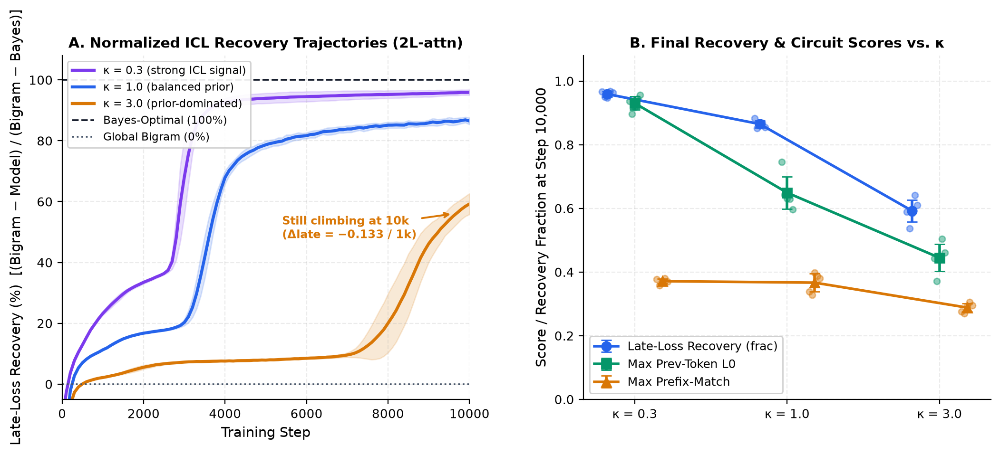
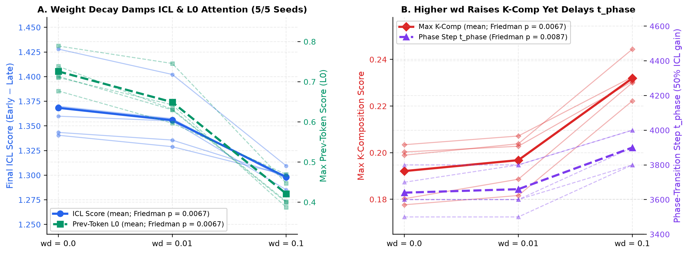

# Induction Heads & Emergent In-Context Learning — From-Scratch Reproduction & 35-Run Sweep

From-scratch PyTorch + `einops` reproduction of **Olsson et al. (2022)**, *"In-context Learning and Induction Heads"*, on online Zipfian In-Context Markov Chains (ICMC) with exact analytical **Global Bigram** and **Bayes-Optimal Dirichlet-Multinomial** baselines, spanning a **35-run** multi-seed sweep (`seeds 0–4`, `10,000` steps / `~164M` tokens per run; `50.45 min` total on a single RTX 5070) and zero-training checkpoint causal ablation diagnostics.

## TL;DR

- **Hard 1-Layer Depth Barrier & Sharp 2-Layer Phase Transition:** `1L-attn` stays permanently trapped at an in-context unigram ceiling (`val_loss_late = 3.362`, `icl_score = +0.255`, `prefix_match = 0.010`), whereas `2L-attn` undergoes a sharp phase transition at median step **`3,600`** (`86.5%` late-loss recovery toward exact Bayes-optimal) and `2L-full` (Pre-LN + GELU MLP) transitions **3.6× earlier** at median step **`1,000`**, reaching **`98.8%`** of exact Bayes-optimal late-context loss (`1.667` vs. `1.642`).
- **Prior Concentration (`κ`) Sets Transition Speed:** Strong in-context signal (`κ = 0.3`) triggers induction early (`t_phase = 2,900`, `95.9%` recovery), while prior-dominated chains (`κ = 3.0`) delay onset to median step **`8,500`** and remain **actively climbing at step `10,000`** (`Δval_loss_late = −0.133` over steps `9k → 10k`, ~10× faster than `κ = 0.3 / 1.0`).
- **Structural Contrast with Finite-Data Grokking:** In online infinite-data ICL, weight decay is **not** required to trigger generalization (`wd = 0.0` achieves the best ICL score). Increasing `wd ∈ {0.0, 0.01, 0.1}` **monotonically damps** `icl_score` and `prev_token_L0` across **5/5 seeds** (Friedman $p = 0.0067$) and **delays** `t_phase` by `+300` steps ($p = 0.0087$), while **monotonically increasing** Frobenius K-composition alignment (`0.192 → 0.197 → 0.232`, **5/5 seeds**, $p = 0.0067$).
- **Resolution of the Causal Ablation Paradox (Distributed L1 vs. Specialized L0):** Naive single-head L1 ablation looks unselective because **all `4 / 4` Layer-1 heads** become induction heads across all `30` 2L checkpoints (`120 / 120` heads, minimum `prefix_match ≥ 0.234`). Progressive `0 → 4` L1 zero-ablation completely erases ICL (`1.356 → −0.002` in `2L-attn`; `1.554 → −0.056` in `2L-full`) and exposes **`1.99×` super-additive backup redundancy** in `2L-full` vs. near-linear **`1.16×`** additivity in `2L-attn`. Conversely, Layer 0 is sharply specialized (`2L-full`: one `0.990` prev-token head whose single-head ablation destroys **`82.4%`** of ICL, `54×` larger than L0 controls; across all `120` L0 heads, Spearman $\rho = 0.850, p = 1.17 \times 10^{-34}$).


---

## 1. Synthetic Task, Analytical Baselines & Architectures

- **Online Zipfian Dirichlet-Markov Data ([`src/data.py`](src/data.py)):** Vocabulary `V = 64`, sequence length `T = 256`. A fixed base transition matrix `P_base` (`data_seed = 12345`) permutes normalized `rank^(-0.8)` independently per row. Each fresh training sequence draws its own Markov matrix $P_i \sim \text{Dirichlet}(\kappa P_{\text{base}, i})$ on GPU via exact log-space Gamma boost ($\text{Gamma}(\alpha+1, 1) \cdot U^{1/\alpha}$ + softmax, eliminating float32 underflow at $\kappa = 0.3$) in chunked batches (`~0.4 ms / 64-seq batch`).
- **Fixed Deterministic Validation & Probe:** For each $\kappa \in \{0.3, 1.0, 3.0\}$, `n_val = 512` sequences (`val_seed = 99999`) carry exact precomputed **Global Bigram** ($-\log P_{\text{base}}[x_t, x_{t+1}]$) and **Bayes-Optimal ICL** ($(\kappa P_{\text{base}}[u] + \text{counts}[u]) / (\kappa + \sum \text{counts}[u])$) losses on early (`pos 1..31`) and late (`pos 192..254`) positions. A fixed repeated-token probe (`n_probe = 128`, `[r_0..r_63, r_0..r_63]`, zero consecutive duplicates) measures Olsson et al. prefix-matching (`t -> t - 63`) and L0 previous-token (`i -> i - 1`) scores.
- **Controlled Models ([`src/model.py`](src/model.py)):** Shared `d_model = 128`, `n_heads = 4` (`d_head = 32`), learned positional embeddings (`max_len = 256`), bias-free attention projections (`W_Q, W_K, W_V, W_O`) and directly accessible `W_E, W_pos, W_U`:
  1. `1L-attn` (`114,688` params): 1-layer attention-only, no MLP, no LayerNorm.
  2. `2L-attn` (`180,224` params): 2-layer attention-only, no MLP, no LayerNorm.
  3. `2L-full` (`444,928` params): 2-layer Pre-LayerNorm Transformer with `d_mlp = 512` GELU MLP.
- **Optimization ([`src/train.py`](src/train.py)):** Constant-LR `AdamW` (`lr = 1e-3`, `betas = (0.9, 0.98)`, weight decay on $\ge 2\text{D}$ tensors), `batch_size = 64`, `10,000` steps (`~164M` tokens/run), logged every `100` steps. Throughput on RTX 5070: `4.8 s/1k` (`1L-attn`), `8.8 s/1k` (`2L-attn`), `12.0 s/1k` (`2L-full`); peak VRAM `≤ 659 MB`; disk `0.5–1.9 MB` per run.

---

## 2. Quantitative Results Across the 35-Run Sweep (`seeds 0–4`)

Phase-transition timing is measured two ways from `metrics.jsonl`: `t_icl50` (first step crossing `50%` of final ICL gain above the pre-transition 1L unigram plateau) and `t_slope` (midpoint of the `500`-step window with steepest drop in `val_loss_late`).

### Axis 1 — Architecture & Depth Barrier (`κ = 1.0`, `wd = 0.01`)

Analytical baselines at `κ = 1.0`: **Global Bigram** `late = 3.713` | **Bayes-Optimal** `late = 1.642`, `ICL = 1.571`.

| Arch | `val_loss_late` (mean ± std) | `icl_score` (mean ± std) | Late Recovery | `prevL0` | `pmatch` | `K-comp` | `t_icl50` med (range) | `t_slope` med (range) |
| :--- | :---: | :---: | :---: | :---: | :---: | :---: | :---: | :---: |
| **`1L-attn`** | `3.362 ± 0.002` | `0.255 ± 0.003` | `16.9%` | `0.041` | `0.010` | `n/a` | *never* | *never* |
| **`2L-attn`** | `1.922 ± 0.023` | `1.356 ± 0.026` | `86.5%` | `0.649` | `0.367` | `0.197` | **`3,600`** (`3,500–3,800`) | **`3,450`** (`3,450–3,650`) |
| **`2L-full`** | **`1.667 ± 0.001`** | **`1.554 ± 0.001`** | **`98.8%`** | **`0.990`** | `0.277` | `0.194` | **`1,000`** (`900–1,000`) | **`750`** (`650–750`) |

### Axis 2 — Prior Concentration Scaling (`2L-attn`, `wd = 0.01`)

| `κ` | Bigram / Bayes `late` | Model `val_loss_late` | `icl_score` (Bayes) | Late Recovery | `prevL0` | `pmatch` | `t_icl50` med (range) | `Δlate (9k→10k)` | Converged? |
| :---: | :---: | :---: | :---: | :---: | :---: | :---: | :---: | :---: | :---: |
| **`0.3`** | `3.752` / `0.595` | `0.724 ± 0.027` | `1.747` (`1.802`) | **`95.9%`** | `0.930` | `0.371` | **`2,900`** (`2,900–3,200`) | `−0.0119` | Yes |
| **`1.0`** | `3.713` / `1.642` | `1.922 ± 0.023` | `1.356` (`1.571`) | **`86.5%`** | `0.649` | `0.367` | **`3,600`** (`3,500–3,800`) | `−0.0129` | Yes |
| **`3.0`** | `3.700` / `2.677` | `3.094 ± 0.035` | `0.526` (`0.879`) | **`59.2%`** | `0.445` | `0.288` | **`8,500`** (`7,900–8,900`) | **`−0.1334`** | **No (still climbing)** |



### Axis 3 — Weight Decay in Online ICL vs. Finite-Data Grokking (`2L-attn`, `κ = 1.0`)

Paired across `seeds 0–4`, every metric shifts monotonically with weight decay (Friedman test):

| Metric | `wd = 0.0` | `wd = 0.01` | `wd = 0.1` | Monotonic Seeds | Friedman $\chi^2$ | $p$-value |
| :--- | :---: | :---: | :---: | :---: | :---: | :---: |
| **`icl_score`** | **`1.368 ± 0.032`** | `1.356 ± 0.026` | `1.298 ± 0.008` | `5 / 5` ↓ | `10.00` | **`0.0067`** |
| **`val_loss_late`** | **`1.907 ± 0.030`** | `1.922 ± 0.023` | `1.997 ± 0.005` | `5 / 5` ↑ | `10.00` | **`0.0067`** |
| **`max_prev_token_L0`** | **`0.726 ± 0.037`** | `0.649 ± 0.051` | `0.421 ± 0.032` | `5 / 5` ↓ | `10.00` | **`0.0067`** |
| **`max_prefix_match`** | **`0.373 ± 0.026`** | `0.367 ± 0.028` | `0.328 ± 0.019` | `5 / 5` ↓ | `10.00` | **`0.0067`** |
| **`max_k_composition`** | `0.192 ± 0.011` | `0.197 ± 0.010` | **`0.232 ± 0.007`** | `5 / 5` ↑ | `10.00` | **`0.0067`** |
| **`weight_l2_norm`** | `79.88` | `78.21` | `76.43` | `5 / 5` ↓ | `10.00` | **`0.0067`** |
| **`t_phase (t_icl50)`** | `3,600` (`3.5k–3.8k`) | `3,600` (`3.5k–3.8k`) | **`3,900`** (`3.8k–4.0k`) | delayed at `0.1` | `9.50` | **`0.0087`** |

Unlike finite-data grokking (where `wd` destroys memorization and accelerates generalization as `1 / wd`), online ICMC has no finite training set to memorize: higher `wd` aligns the QK/OV subspaces (raising Frobenius K-composition), yet damps attention logit sharpness and delays the induction cliff by `+300` steps.



---

## 3. Resolving the Causal Ablation Paradox: Distributed L1 vs. Specialized L0

Zero-training checkpoint ablations across all `30` 2L `final.pt` checkpoints ([`src/analysis.py`](src/analysis.py)) resolve why single-head L1 ablation showed `top_head_drop ≈ control_drop`:

1. **All `4 / 4` L1 heads become induction heads** in every 2L run (`κ = 1.0, wd = 0.01`):
   - `2L-attn` L1 `prefix_match` by sorted rank: `0.367 ± 0.028`, `0.358 ± 0.024`, `0.353 ± 0.024`, `0.344 ± 0.027` (min across all `20` heads: `0.307`).
   - `2L-full` L1 `prefix_match` by sorted rank: `0.277 ± 0.008`, `0.267 ± 0.008`, `0.258 ± 0.009`, `0.252 ± 0.011` (min across all `20` heads: `0.234`).
2. **Progressive cumulative L1 ablation (`0 → 4` heads zero-ablated in descending `prefix_match` order)** completely eliminates ICL and separates linear additivity (`2L-attn`) from nonlinear backup redundancy (`2L-full`):

| Arch (`κ=1.0, wd=0.01`) | `0` ablated (intact) | `1` (top) | `2` | `3` | `4` (all L1) | $\Sigma$ Single Drops | All-4 Drop | Redundancy Ratio (`all4 / Σsingle`) |
| :--- | :---: | :---: | :---: | :---: | :---: | :---: | :---: | :---: |
| **`2L-attn`** (remaining ICL) | `1.356 ± 0.026` | `1.078 ± 0.052` | `0.751 ± 0.038` | `0.381 ± 0.022` | **`−0.002 ± 0.004`** | `1.174` | `1.358` | **`1.16× ± 0.04`** |
| **`2L-full`** (remaining ICL) | `1.554 ± 0.001` | `1.341 ± 0.024` | `0.892 ± 0.042` | `0.123 ± 0.096` | **`−0.056 ± 0.010`** | `0.811` | `1.610` | **`1.99× ± 0.09`** |

3. **Layer 0 is sharply specialized and causally decisive:** In `2L-full`, L0 concentrates into a **single** previous-token head per seed (`0.990 ± 0.001` vs. `0.030 / 0.025 / 0.022` for Ranks 2–4). Zero-ablating that single L0 head drops ICL by **`+1.281`** (`82.4%` of total ICL) vs. **`+0.024`** for control L0 heads (**`54×`** selectivity; in `2L-attn`, `+1.012` vs. `−0.046`). Across all `120` L0 heads (`30` checkpoints × `4` heads), L0 `prev_token` score strongly predicts causal single-head ICL drop (Spearman **$\rho = 0.8501, p = 1.17 \times 10^{-34}$**).


---

## 4. Environment & Reproducibility

### Installation

- **Portable install (macOS / Linux / CPU / GPU):** install direct dependencies with CUDA suffixes stripped from [`requirements.txt`](requirements.txt) (mirrored in [`pyproject.toml`](pyproject.toml)):
  ```bash
  pip install -r requirements.txt
  ```
- **Exact hardware lockfile (`eurus`, RTX 5070, Python 3.12.16, PyTorch 2.15.0+cu132, CUDA 13.2):** see [`env/eurus-cu132.lock.txt`](env/eurus-cu132.lock.txt) for the full frozen package set.
- **Precomputed 35-run summary table:** [`artifacts/data/sweep_summary.csv`](artifacts/data/sweep_summary.csv) contains all 35 final run metrics, analytical baselines, ablations, and timings for immediate inspection without retraining.

### Running Tests, Training & Analysis

Commands work identically from a standalone `induction/` checkout (shown below) or from the parent monorepo root using the `induction.src.*` module prefix:

```bash
# 1. Mandatory pre-run sanity suite (8 tests: shapes/causality, analytical baselines,
#    synthetic attention metrics, K-composition identity, CUDA determinism [skipped on CPU], overfit)
pytest -v

# 2. Single training run example (2L-attn, kappa=1.0, wd=0.01, seed=0, 10k steps)
python -m src.train \
  --arch 2L-attn --kappa 1.0 --wd 0.01 --seed 0 --steps 10000 \
  --out-dir runs/single_2L_attn_seed0

# 3. Full resumable 35-run overnight sweep (~50 min on RTX 5070; --dry-run lists all 35 jobs)
python -m src.overnight_sweep \
  --out-root runs/overnight_sweep --steps 10000

# 4. Stage 2 trajectory analysis, 30-checkpoint cumulative ablations, and Figures 1–5 (~13 s on GPU)
python -m src.analysis \
  --sweep-root runs/overnight_sweep \
  --figures-dir artifacts/figures
```
